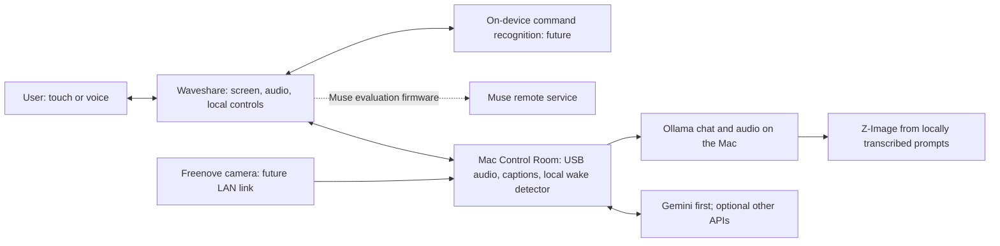

# Architecture

Current route, 2026-11-06: **Face Lab 0.9.3 ↔ native USB ↔ Mac Control Room ↔ Gemini 3.8 Live**. The Mac runs local keyword spotting and pause-based capture. Gemini receives one bounded command at a time and returns PCM in Charon's voice. The board checks the reply before speaker playback. Text uses Gemini 3.8 Flash. The Mac keeps the provider credential. [Gemini voice contract](GEMINI-VOICE.md) · [Acceptance](PROJECT-STATUS.md)

Decision date: 2026-10-29; reconciled 2026-11-06. Proposed interfaces below are not implemented unless the status document says otherwise.

## Previous execution routes — 2026-10-30

The Waveshare holds both the Muse ESP-IDF 6 evaluation and Face Lab. Control Room selects the resident app over USB. Face Lab handles Mac-hosted Gemini and Ollama. Muse connects directly over Wi-Fi for button conversations and accepts typed prompts from the Mac over USB. Android enrollment survived switching. [Provider switching](VOICE-PROVIDERS.md) · [Muse pairing and verification](MUSE-PAIRING.md)

The current Gemini laptop route supports text and bounded spoken turns. Local wake detection runs on the Mac, and voice controls are explicit. Repeated-turn reliability, physical switch acceptance, camera integration and portable power remain separate checks. See [voice and power plan](VOICE-AND-POWER-PLAN.md).

## Device roles

The Waveshare is the face and voice of MR. Robot: touch UI, buttons, local feedback, microphones, speaker, card storage and networking. Keep the Freenove with its working camera as a separate optional camera node. Keep the parallel ribbon on Freenove and give each board its own USB connection. The proposed authenticated Wi-Fi path carries a requested still to the Mac. [Connection drawings](BREADBOARD-CAMERA-DISPLAYS.md)

## What local means

| Mode | Where inference happens | Connectivity | Current position |
| --- | --- | --- | --- |
| Offline device | ESP32-S3 | None for supported commands | Feasible candidate: ESP-SR command recognition; not implemented or benchmarked here. |
| Local computer | Mac or other more capable host | Local Wi-Fi; internet need depends on installed models/services | Route for richer private conversation if a host stays on. Available compute/models have not been inventoried. |
| Muse | Muse remote infrastructure | Muse account, phone provisioning and internet | SDK supports this board; model weights/offline inference are not supplied. |
| API | Laptop backend + selected provider | Internet for Gemini; USB to board | Gemini 3.8 Flash text and 3.8 Live speech work through the Mac. Other voice providers remain separate work. |

An offline language-model experiment would need a specific licensed model, quantized size, inference runtime and measured speed. No deployable local Muse model was found in the supplied SDK. Even a hypothetical 1-billion-parameter model at 4 bits needs roughly 500 MB for weights alone, before runtime/cache; this is far beyond 8 MB PSRAM. Much smaller experimental models are a research item, not a promise of useful conversational AI. SD storage does not remove the working-memory and compute limits.

## First interaction and UI boundaries

Tap-to-talk and wake mode require explicit enabling in Control Room. Show microphone activity, bounded capture and a cancel affordance. Wake mode streams microphone audio to the Mac for local detection; only the triggered command is sent to Gemini. Keep camera submission under direct user control. Do not silently send a local-mode request to a cloud provider.

Use actual state for idle, waiting for a tap or wake phrase, listening, thinking, receiving, speaking, stopped and error. Identify local wake detection separately from command capture. Offline face previews must not imply a working host or provider connection. Do not show Muse as the active mode in Face Lab or invent a response progress percentage.

## Software boundaries

1. **Bring-up:** `firmware/waveshare-bringup/` is a temporary diagnostic with no network or external drivers.
2. **Muse evaluation:** use a separate pinned upstream ESP-IDF checkout and the existing non-C BSP. Keep upstream files identifiable; document any future patch. Do not combine SDK dependencies with the old Arduino camera project.
3. **Custom assistant:** Face Lab uses small modules for verified board support, UI state, audio capture/playback and bounded USB transport. Pin assignments stay in the hardware inventory.
4. **Backend:** the Mac owns provider credentials, local wake detection and the Gemini Live connection. Text and audio use separate bounded paths; image integration remains planned.

### Implemented foundations — 2026-10-29 follow-up

`firmware/assistant/` now contains the custom face application with board pins, app state, renderer and bounded control parser in separate modules. The owner visually confirmed the corrected Classic face; USB software acceptance covers all three style IDs, four expression IDs and brightness. `tools/device.py` is the reusable device client for a future PC manager. Settings are volatile; face selection does not select or connect an AI provider.

`backend/mr_robot_backend/providers.py` implements a host-side text adapter boundary for mock, OpenRouter and explicitly configured compatible chat services. It has bounded input/output, TLS verification, timeout/token limits and stable errors. No credentials or upstream API calls were used in tests. Control Room now runs an authenticated loopback service with separate manager/device roles, persistent daily/minute attempts and bounded requests. Native Gemini 3.1 Flash-Lite generation is live-verified, with a short reply delivered to the round display. Keys are host-held. Gemini Free-tier status is owner-confirmed, not independently queried; OpenRouter has a tested key-cap preflight. Speech remains future work. See [PC manager plan](DEVICE-MANAGER-PLAN.md).

## Backend requirements before API use

- Provider secrets stay on the host in ignored local configuration. Record variable names only: `OPENROUTER_API_KEY`, `MR_ROBOT_DEVICE_TOKEN`, `MR_ROBOT_PROXY_URL`, `MR_ROBOT_MODEL`.
- Device credentials must be revocable and scoped to one device. Avoid logging tokens, Wi-Fi passwords, raw audio, images or conversation content by default.
- Verify TLS server certificates; never use an insecure TLS shortcut. Development transport and production transport must be explicitly identified.
- Validate request size/type, response size, timeouts and rate limits; set a daily usage cap before live provider requests.
- Require authentication before processing; reject unauthenticated requests and test with a fake provider before spending API credit.
- Choose speech-to-text and text-to-speech separately; a chat completion endpoint alone is not a full voice assistant.

## Power and storage boundaries

Use USB first. Actual display/audio/Wi-Fi current draw, peak current, speaker rating, battery protection, connector polarity and charge current are unverified. Do not estimate battery runtime or connect an unknown battery yet. Measure USB current and audio peaks before choosing a battery design.

Use the SD card for assets, selected notes and explicit recordings after validation. Keep credentials out of SD. Define retention and maximum space before storing personal media. See [card plan](SD-CARD-PLAN.md).

Sources: [Muse SDK](https://github.com/facebookincubator/muse-gadget-sdk/tree/4737636133c9a0253d0b778333605b16fd2626c1/esp32), [Waveshare hardware reference](https://github.com/waveshareteam/ESP32-S3-Touch-AMOLED-1.75/blob/e4344e70c2fa78a13e8a06566507f1ba8af6672a/HARDWARE_REFERENCE.md), [Espressif offline commands](https://docs.espressif.com/projects/esp-sr/en/latest/esp32s3/speech_command_recognition/README.html).

### Touch and independent-application clarification

Face Lab 0.7.0 builds on verified face, touch, speaker and microphone diagnostics. A live Gemini greeting is now readable as a short host caption; the owner confirmed it. “Our own firmware” means our separate application/state/control modules using documented drivers, not rewriting every hardware driver or modifying the factory Brookesia application. Hardware capability is distinct from enabled software: Wi-Fi/BLE/audio exist physically, while the current app enables display, USB, touch, explicit audio diagnostics, raw SD metadata and short host captions. The factory backup is optional local recovery data, unused by builds.

## API route accepted — 2026-10-30

The laptop owns provider configuration, credentials, inference and the browser manager. The ESP32 holds no API key and starts no Wi-Fi connection. Successful text inference can deliver a hex-framed, printable-ASCII caption over the existing serialized USB client. The caption is a short volatile preview with a source label and 60-second expiry; the full reply stays in the laptop UI. Model text is never interpreted as an executable command. A device delivery failure does not regenerate the model response.

The first provider was native Google Gemini 3.1 Flash-Lite. Current configuration uses Gemini 3.8 Flash for stateless text and a separate 3.8 Live path for bounded voice turns. Conversation memory, camera submission and Wi-Fi transport remain unimplemented. The Mac must remain running for this route. See API-HOST-SETUP.md and GEMINI-VOICE.md for actual service/security boundaries.

USB status/control clients preserve native modem-line state and disable POSIX hangup resets. This is a host transport concern, verified separately from the firmware's reboot behavior. Muse status exposes only board and connection booleans; raw network/account metadata is not part of the public CLI. See ADR025 and MUSE-PAIRING.md.
